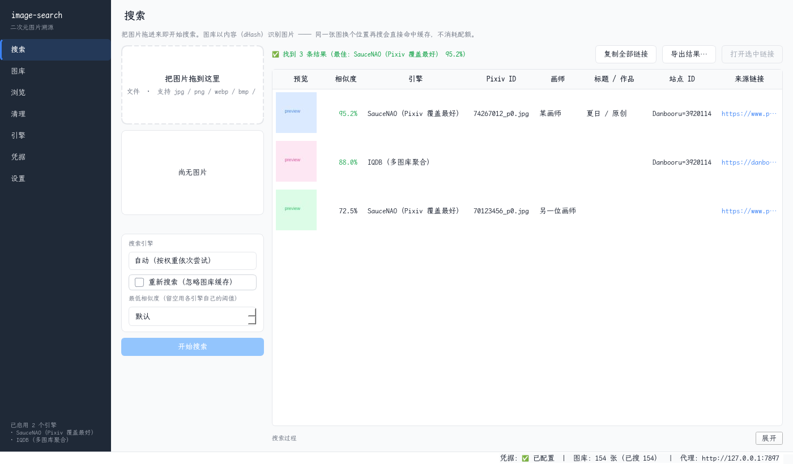

# image-search — 二次元图片溯源工具

拖一张图进来，查出它的原始出处（Pixiv / Danbooru / Twitter 等），并把能批量下载的链接整理出来。

**不下载任何图片**，只输出链接与元数据。

> ⚠️ **预发布（pre-release）** —— 尚未正式发布，处于测试阶段。
> - Linux 已长期日常使用；Windows 已实机验证，**暂未进行完整测试**
> - 接口、配置格式、数据表结构仍可能变动；升级前请备份 `data/`
> - 许可为[预发布许可](LICENSE)：**禁止商业使用**；修改后分发必须同样开源。正式版将改为 **GPL-3.0**
> - 第三方组件许可见 [THIRD_PARTY_NOTICES.md](THIRD_PARTY_NOTICES.md)（Qt 为 LGPL-3.0）

---

## 目录

| 想做什么 | 去哪看 |
|---|---|
| 装上并搜第一张图 | 本页往下看 |
| 配置项、批量策略、导出格式 | [docs/usage.md](docs/usage.md) |
| **新增一个站点**（不写代码） | [docs/engines.md](docs/engines.md) |
| 图库：换位置还认得出、清理、判重 | [docs/library.md](docs/library.md) |
| 出问题了（尤其 Windows） | [docs/troubleshooting.md](docs/troubleshooting.md) |
| 想读 / 改代码 | [docs/architecture.md](docs/architecture.md) |
| 打包编译产物 | [docs/packaging-notes.md](docs/packaging-notes.md) |
| 某个设计为什么这么定 | [docs/history.md](docs/history.md) |

---

## 声明：关于 AI 参与

声明：本项目由作者使用AI完成。由于作者缺乏编程能力，作者实际的工作是：

1. 讨论并明确项目的用途，架构。并以行为逻辑链条进行检查。
2. 选择项目技术栈。为AI搜集资料以及提供相关文档，尽量避免其产生边界歪的偏差
3. 测试并提出修改意见，交由AI修改。

尽管作者尽可能地想了一些可能遇到的bug情况，并进行了针对性意见让AI修复。但仍可能遇到各种问题。请您谅解。

---

## 界面



单窗口 + 侧栏，七个页面：搜索 / 图库 / 浏览 / 清理 / 引擎 / 凭据 / 设置。
界面用 PySide6（Qt6），在 KDE Wayland 下走原生 wayland，不做 XWayland 转译。

---

## 作用与特点

- **拖图即搜**：按内容指纹（dHash）识别，同一张图换个位置再搜直接命中缓存，**不消耗配额**
- **图库**：记录搜过的图与结果，可批量识别整个目录（缓存优先、逐张节流、额度用尽可停）
- **配置化引擎**：内置 SauceNAO / IQDB / Ascii2D / TraceMoe / Danbooru 五个常见引擎，
  也可以自行增加 —— 填一张字段映射表就行（JSON / HTML 两类模板），不写代码
- **导出**：urls.txt / CSV / JSON / JSONL / HTML 缩略图墙 / 复制到剪贴板
- **凭据隔离**：API Key 只写进 `.env`（0600），不进 `config.json`、不入库

---

## 快速开始

需要 **Python 3.10+**，其余依赖首次运行时自动装进 `.venv`，不污染系统 Python。

### Linux

```bash
./run-gui.sh            # 图形界面
./run.sh search 图.jpg   # 命令行
```

### Windows

```bat
run-gui.bat             :: 图形界面
run.bat search 图.jpg    :: 命令行
```

> **PowerShell 要写 `.\run-gui.bat`** —— 当前目录不在 PATH 里，直接敲会 `CommandNotFoundException`。

装了多个 Python 也不用手动挑：`bootstrap.py` 会检查版本，太旧时自动换到更新的解释器重跑。
找不到 Python 会给出可照抄的处理办法，不会让你卡在「装依赖失败」上。

---

## 使用

### 界面

单窗口 + 侧栏，七个页面：

| 页面 | 作用 |
|---|---|
| **搜索** | 拖图进左侧方框即搜；结果表可复制/打开链接；命中图库缓存会标注「未消耗配额」 |
| **图库** | 登记图库根路径、看占用；「识别未搜索的图…」把整个目录跑一遍 |
| **浏览** | 缩略图墙，按路径/文件名筛选，双击打开，右键复制路径 |
| **清理** | 按路径/按类别清理持久化数据；先预演、再执行，显示真实回收量 |
| **引擎** | 表单由各引擎的配置声明自动生成；可启停、排序、新建、测试 |
| **凭据** | **API Key 只在这里填**，程序负责写进 `.env` |
| **设置** | 代理与探活地址、是否使用图库、缩略图缓存上限 |

### 命令行

```bash
./run.sh search 图.jpg                 # 搜索（按配置顺序自动选引擎）
./run.sh search 图.jpg -e iqdb         # 指定引擎
./run.sh search 图.jpg --url           # 顺带生成 Pixiv 图片直链
./run.sh search 图.jpg --export all    # 搜完直接导出
./run.sh batch ./待查目录               # 批量识别
./run.sh batch ./待查目录 --dry-run     # 只预览会处理多少张、消耗多少额度
./run.sh engines list                  # 引擎列表与状态
./run.sh config show                   # 查看配置（凭据自动脱敏）
```

Windows 把 `./run.sh` 换成 `run.bat`。

### 几个常见流程

- **搜一张图** → 拖进窗口（或点方框选文件），等结果；同一张图再搜会直接复用缓存
- **跑一整个目录** → 图库页「识别未搜索的图…」，开跑前可以取消勾选排除某几张
- **拿链接去下载** → 结果表「复制全部链接」或「导出结果…」（不下载图片，只给地址）
- **加一个站点** → 引擎页「新建引擎…」，按提示填映射表，点「测试这个引擎」验证

更多细节（配置项、批量策略、导出格式、引擎选择）见 [docs/usage.md](docs/usage.md)。

---

## 数据放在哪里

| 类别 | 内容 | 位置 |
|---|---|---|
| 只读资源 | 代码、`config.example.json`、`LICENSES/` | 程序所在目录 |
| **可写数据** | `config.json`、`.env`、`data/`（图库 + 缩略图）、`output/` | 见下 |

可写数据按以下顺序决定：

1. 环境变量 `IMGSEARCH_DATA_DIR`
2. exe 旁边放一个 `portable.txt` → 数据留在 exe 旁（**便携版**）
3. **打包运行** → Windows `%LOCALAPPDATA%\image-search`、macOS `~/Library/Application Support/image-search`、Linux `$XDG_DATA_HOME/image-search`（缺省 `~/.local/share/image-search`）
4. **源码运行** → 仓库目录（就是你现在看到的样子）

> 从源码跑的**不需要迁移任何东西** —— 第 4 条与改造前完全一致。

---

## 目前状态

- **尚未发布编译产物**。打包前的准备与实测数据见 [docs/packaging-notes.md](docs/packaging-notes.md)
- 测试：949 项（pytest），Linux 与 Windows 均可运行
- 已知限制：`PySide6` 限制在 `<6.12`（6.12.0 有可复现的退出崩溃），细节见 [troubleshooting](docs/troubleshooting.md)

---

## 许可

- **本项目**：[预发布许可](LICENSE) —— 允许非商业使用与修改；修改后分发须以同等许可开源；**禁止商业使用**。正式版将改为 **GPL-3.0**
- **第三方组件**：见 [THIRD_PARTY_NOTICES.md](THIRD_PARTY_NOTICES.md)。Qt / PySide6 使用 **LGPL-3.0**，本项目以动态链接方式使用、未修改其源码
- 商业使用请先联系作者取得书面许可
