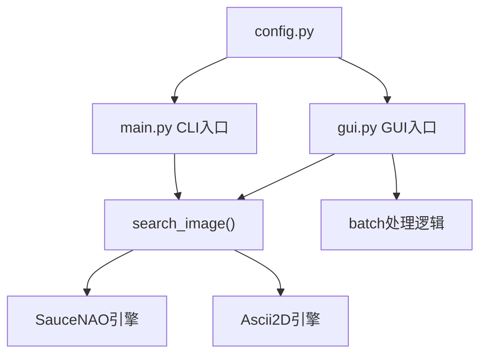

# GUI 图形界面设计方案

> **历史文档，仅供参考。**
>
> 这是项目早期（tkinter 时代）的设计记录，描述的是**旧架构**：
> 当时每个引擎是一个 Python 文件，GUI 用 tkinter。
> 现在的实现已经不同：引擎全部由配置预设提供（`imgsearch/engines/adapters/presets.py`），
> 界面是 PySide6。保留这份文档是为了记录设计过程，
> 其中的代码片段、文件路径、命令行都**可能已经过时**。

---


## 技术选型

| 选项 | 选择 | 原因 |
|------|------|------|
| GUI 框架 | **tkinter** (内置) | Python 3.12 自带，零额外依赖，PyInstaller 打包兼容 |
| 图片预览 | **Pillow.ImageTk** | 项目已有 Pillow 依赖，可直接用 |
| 线程模型 | **threading** | 搜索操作通过网络请求需异步执行，避免界面冻结 |
| 打开链接 | **webbrowser** | Python 内置模块，一键打开 Pixiv 页面 |

## 架构设计



- `gui.py` 是 GUI 入口点，与 `main.py` 同级
- 核心搜索函数 `search_image()` 在 `main.py` 中已导出，GUI 直接导入复用
- 配置管理、搜索引擎等模块均保持原样，不做修改
- CLI 和 GUI 完全独立，互不影响

## GUI 窗口布局

```
+------------------------------------------------------------------+
| 🎨 二次元图片溯源工具  [配置] [批量搜索]                        |
+------------------------------------------------------------------+
|                                                                    |
|  图片路径: [_____________________________] [浏览...] [🔍搜索]    |
|                                                                    |
|  +----------------------------+                                    |
|  |                            |   图片信息: 1920x1080              |
|  |    (图片缩略图预览)        |   JPEG | 256.3 KB                 |
|  |                            |   文件哈希: a1b2c3d...            |
|  +----------------------------+                                    |
|                                                                    |
|  搜索结果:                                                         |
|  +------------------------------------------------------------+  |
|  | [1] SauceNAO  相似度: 92.2%                                |  |
|  |     📌 Pixiv: 74267012_p0.jpg                              |  |
|  |     🔗 https://www.pixiv.net/artworks/74267012             |  |
|  |     🎨 画师: --DE--    📄 标题: Bronya                    |  |
|  +------------------------------------------------------------+  |
|                                                                    |
|  [🌐 打开Pixiv] [💾 下载原图] [📊 导出CSV]                       |
+------------------------------------------------------------------+
|  状态日志:                                                        |
|  🌐 正在使用 SauceNAO 搜索...                                     |
|  ✅ 匹配到 3 个结果，最高相似度 92.2%                             |
|  [SauceNAO 配额] 今日剩余: 85 次 | 30秒内剩余: 3 次              |
+------------------------------------------------------------------+
```

## 函数设计

### 入口函数

| 函数 | 文件 | 说明 |
|------|------|------|
| `run_gui()` | `gui.py` | 启动主窗口、事件循环 |

### 核心功能函数

| 函数 | 说明 |
|------|------|
| `_browse_image()` | 打开文件选择对话框，支持 jpg/png/webp/bmp/gif |
| `_browse_folder()` | 打开目录选择对话框（批量模式） |
| `_do_search()` | 在新线程中调用 `search_image()`，完成后通过回调更新界面 |
| `_show_single_results()` | 将 `SearchResult` 列表渲染到结果面板 |
| `_batch_start()` | 批量模式下的主循环，异步执行 |
| `_batch_update_progress()` | 更新批量进度条和当前结果 |
| `_open_pixiv()` | 调用 `webbrowser.open()` 打开 Pixiv 作品页 |
| `_save_csv()` | 调用 CSV 保存逻辑 |
| `_show_config_window()` | 弹出配置窗口（API Key / 代理设置） |
| `_preview_image()` | 用 PIL 读取图片，缩放后以 `ImageTk.PhotoImage` 显示 |

## 文件结构

```
search/
├── main.py          # CLI 入口（不变）
├── gui.py           # GUI 入口（新增）
├── config.py        # 配置管理（不变）
├── requirements.txt # 依赖（不变）
├── build_exe.bat    # 打包脚本（更新）
├── engines/         # 搜索引擎（不变）
├── processor/       # 图片处理（不变）
└── utils/           # 网络工具（不变）
```

## 任务步骤

1. 创建 `gui.py` 文件，包含所有 GUI 代码
2. 更新 `build_exe.bat` 支持同时打包 CLI 和 GUI 两种入口
3. 验证 GUI 单图搜索功能
4. 验证 GUI 批量搜索功能
5. 验证 GUI 配置管理功能
