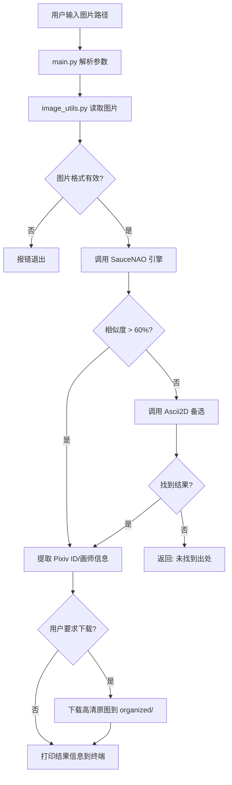
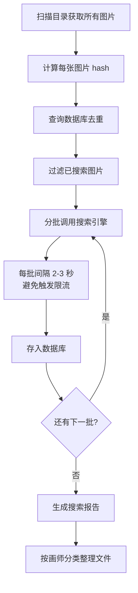

# 🖼️ 二次元图片溯源工具 — 实施方案

## 背景

拥有大量二次元图片，但是：
1. **质量被压缩** — 想要找到 Pixiv 等原始来源的高清原图
2. **找不到出处** — 大量图片的画师/Pixiv ID/作品信息完全未知

## 技术选型

| 组件 | 选择 | 原因 |
|------|------|------|
| 以图搜图引擎 | **SauceNAO API**（主）+ **Ascii2D**（备） | SauceNAO 对 Pixiv 覆盖最好，用户已注册 |
| 高清下载 | **Pixiv 原图下载** | 直接从 Pixiv 获取原始分辨率 |
| 数据存储 | **SQLite** | 轻量、零配置，适合单机使用 |
| 交互方式 | **CLI 命令行工具** | 用户偏好，简单高效 |
| 开发语言 | **Python 3.10+** | 生态丰富，图片处理库完善 |

## 阶段一：单图溯源工具（MVP）

### 目标
实现核心功能：输入一张图片 → 搜索出处 → 显示画师/Pixiv ID → 下载高清原图

### 涉及文件

| 文件 | 说明 |
|------|------|
| [`image-search/main.py`](../image-search/main.py) | 主入口，CLI 参数解析 |
| [`image-search/config.py`](../image-search/config.py) | SauceNAO API Key、代理等配置 |
| [`image-search/requirements.txt`](../image-search/requirements.txt) | 依赖清单 |
| [`image-search/engines/base.py`](../image-search/engines/base.py) | 搜索引擎基类，定义统一接口 |
| [`image-search/engines/saucenao.py`](../image-search/engines/saucenao.py) | SauceNAO API 实现 |
| [`image-search/engines/ascii2d.py`](../image-search/engines/ascii2d.py) | Ascii2D 爬虫实现 |
| [`image-search/processor/image_utils.py`](../image-search/processor/image_utils.py) | 图片读取/哈希计算/格式判断 |
| [`image-search/utils/network.py`](../image-search/utils/network.py) | 网络请求封装（超时/重试/代理） |

### 详细实现步骤

#### Step 1：初始化项目结构
- 在 [`image-search/`](../image-search/) 下创建 `engines/`、`processor/`、`utils/` 子目录及 `__init__.py`
- 更新 [`requirements.txt`](../image-search/requirements.txt) 加入 `Pillow`、`requests` 等

#### Step 2：config.py — 配置管理
```python
SAUCENAO_API_KEY = "your_key_here"  # 用户填入
SAUCENAO_API_URL = "https://saucenao.com/search.php"
PROXY = None  # 可选项，如 http://127.0.0.1:7890
OUTPUT_DIR = "../organized"  # 输出目录
DB_PATH = "../data/image_metadata.db"
```

#### Step 3：engines/base.py — 搜索引擎基类
- 定义抽象基类 `SearchEngine`
- 统一方法：`search(image_path) -> List[SearchResult]`
- `SearchResult` 数据类包含：`source`、`similarity`、`pixiv_id`、`artist`、`title`、`ext_urls`、`thumbnail`

#### Step 4：engines/saucenao.py — SauceNAO 引擎
- 调用 SauceNAO API（`https://saucenao.com/search.php?api_key=xxx&file=...`）
- 解析返回的 JSON 结果
- 筛选 `db` 为 Pixiv（index=5）的结果
- 提取：Pixiv ID、画师名、作品标题、相似度、原图 URL
- 实现：Pixiv 原图下载（利用 Pixiv 的 i.pximg.net 直链）

#### Step 5：engines/ascii2d.py — Ascii2D 备选引擎
- 使用 `requests` + BeautifulSoup 解析 Ascii2D 搜索结果
- 提取画师名、Pixiv ID 等信息
- 作为 SauceNAO 未找到时的 fallback

#### Step 6：processor/image_utils.py — 图片处理
- 支持常见格式：jpg/png/webp/bmp/gif
- 提取基础信息：尺寸、文件大小、格式
- 计算 dHash/pHash 用于后续去重

#### Step 7：utils/network.py — 网络工具
- 统一的 `requests.Session` 封装
- 支持超时设置（默认 30s）
- 支持重试机制（最多 3 次）
- 支持代理配置

#### Step 8：main.py — CLI 主入口
- 使用 `argparse` 解析命令行参数
- 支持命令：
  ```
  # 单张图片搜索
  python main.py search 图片路径
  
  # 搜索并下载原图
  python main.py search 图片路径 --download
  
  # 批量搜索目录
  python main.py batch wating_for_search/
  ```

### 运行流程



## 阶段二：批量处理 + 数据库

### 目标
- 扫描整个目录批量溯源
- SQLite 数据库持久化存储结果
- 生成搜索报告

### 新增/修改文件

| 文件 | 说明 |
|------|------|
| [`image-search/storage/database.py`](../image-search/storage/database.py) | SQLite CRUD 操作 |
| [`image-search/storage/organizer.py`](../image-search/storage/organizer.py) | 文件整理：按画师/按作品分类 |
| [`image-search/utils/reporter.py`](../image-search/utils/reporter.py) | 搜索报告生成 |
| [`image-search/processor/dedup.py`](../image-search/processor/dedup.py) | 去重检测 |
| 更新 [`main.py`](../image-search/main.py) | 增加 batch 命令 |

### 数据库设计

```sql
CREATE TABLE images (
    id INTEGER PRIMARY KEY AUTOINCREMENT,
    file_hash TEXT UNIQUE,          -- 文件 dHash
    original_path TEXT,              -- 原始路径
    file_size INTEGER,              -- 文件大小
    width INTEGER,                  -- 图片宽度
    height INTEGER,                 -- 图片高度
    format TEXT,                    -- 格式
    searched BOOLEAN DEFAULT 0,     -- 是否已搜索
    search_date TIMESTAMP,          -- 搜索时间
    created_at TIMESTAMP DEFAULT CURRENT_TIMESTAMP
);

CREATE TABLE sources (
    id INTEGER PRIMARY KEY AUTOINCREMENT,
    image_id INTEGER REFERENCES images(id),
    source TEXT,                    -- sauceNAO/ascii2D/iqdb
    similarity REAL,                -- 相似度
    pixiv_id TEXT,                  -- Pixiv ID
    artist TEXT,                    -- 画师名
    artist_id TEXT,                 -- 画师 ID
    title TEXT,                     -- 作品标题
    ext_urls TEXT,                  -- 来源 URL 列表(JSON)
    highres_url TEXT,               -- 高清原图 URL
    downloaded BOOLEAN DEFAULT 0,   -- 是否已下载原图
    created_at TIMESTAMP DEFAULT CURRENT_TIMESTAMP
);
```

### 批量处理流程



## 阶段三：元数据补全 + 智能整理

### 目标
- 对 `1库/`、`2库/` 中已有图片补全元数据
- 全库去重
- 文件智能重命名和组织
- 搜索失败图片的 AI 超分选项（可选）

### 新增功能
- 文件名解析（从已有文件名提取 Pixiv ID，跳过搜索直接获取信息）
- 全库扫描 + 数据库比对去重
- 按 `画师/作品名/图片ID.扩展名` 格式组织文件
- 导出搜索报告为 CSV/JSON

## 依赖清单

```
# 核心依赖
requests>=2.28.0
Pillow>=9.0.0

# 搜索引擎
beautifulsoup4>=4.11.0    # Ascii2D 解析

# 可选 - 后续阶段
opencv-python>=4.5.0      # 感知哈希（可选，Pillow 可替代）
```

## CLI 命令参考

```bash
# 阶段一：单图搜索
python main.py search "C:/path/to/image.jpg"
python main.py search "C:/path/to/image.jpg" --download
python main.py search "C:/path/to/image.jpg" --engine sauceNAO

# 阶段二：批量处理
python main.py batch "C:/path/to/directory"
python main.py batch "C:/path/to/directory" --download
python main.py batch "C:/path/to/directory" --workers 3

# 阶段三：数据库管理
python main.py db stats          # 查看统计数据
python main.py db export         # 导出为 CSV
python main.py dedup "C:/path/"  # 去重检测

# 配置
python main.py config set saucenao_key YOUR_KEY
python main.py config set proxy http://127.0.0.1:7890
```
